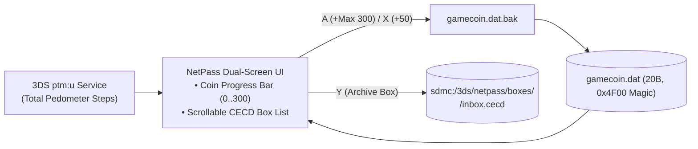

# NetPass (`3ds_netpass`)

<p align="center">
  
  &nbsp;&nbsp;&nbsp;
  
</p>

> **Play Coins & StreetPass (`CTR-P-SPAS`, UniqueId `0x0D3E6`)** — Part of the [**lafiabrew**](https://github.com/orgs/lafiabrew/repositories) Nintendo 3DS Homebrew Suite (companion hub: [`lafiabrew/3ds_hub`](https://github.com/lafiabrew/3ds_hub)).

Nintendo 3DS Play Coin maxer (`300/300` in `gamecoin.dat` with mandatory `.bak` backup), hardware pedometer step reader (`ptm:u`), and StreetPass `CECD` inbox/outbox vault archiver.

---

## Architecture & Data Flow



---

## Controls & Touch Ergonomics (Old 3DS · 2DS · New 3DS XL)

| Button / Input | Action |
|---|---|
| `A` (or Touch `A: MAX PLAY COINS`) | Set Play Coins to **`300/300`** (`gamecoin.dat.bak` created automatically before atomic `.tmp` -> `rename()`) |
| `X` (or Touch `X: ADD +50`) | Add `+50` Play Coins (clamped to `300` max) |
| `D-Pad Up / Down` | Scroll through StreetPass `CECD` boxes (`Mii Plaza`, `Pokémon X/Y`, `OR/AS Eon Ticket`, `US/UM Festival Plaza`) |
| `Y` (or Touch `Y: ARCHIVE`) | Archive selected StreetPass `CECD` box to `sdmc:/3ds/netpass/boxes/<TitleID>/inbox.cecd` |
| `START` | Exit to HOME Menu / Homebrew Launcher |

---

## SD Card Paths & Telemetry Logs

- `sdmc:/3ds/netpass/gamecoin.dat` & `gamecoin.dat.bak` — 20-byte `0x4F00` Play Coin structure and backup
- `sdmc:/3ds/netpass/boxes/<TitleID>/inbox.cecd` — Archived StreetPass CECD box snapshots
- `sdmc:/3ds/logs/netpass.log` — Structured UTC operational log

---

## Build, Verify & Install

```bash
# 1. Run host C11 ASan/UBSan pass-the-pass & fail-the-fail unit + UI tests
make test

# 2. Build optimized ARM11 (-Os -flto + stripped ELF) .elf, .smdh, .3dsx, and .cia
make 3ds && make verify-3ds

# 3. Serve FBI QR code or push .cia over LAN via serve_3ds.py
make qr
```
